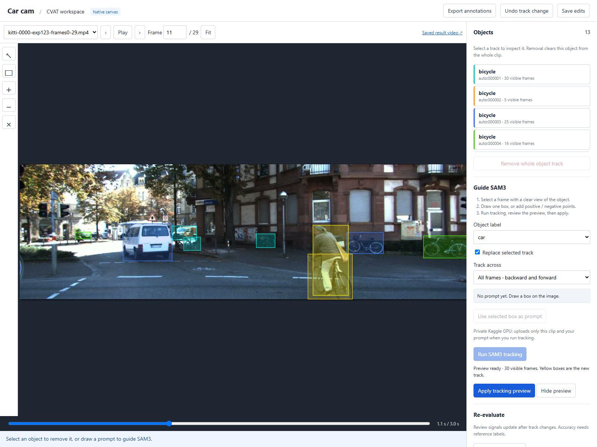

# Car cam label assistant

A local workspace for reviewing and correcting object tracks in driving videos. It combines CVAT’s native annotation canvas with SAM3 tracking, a FastAPI service, and saved video results that can be opened without loading a model.



## What you can do

- Inspect bounding boxes and object tracks frame by frame, play the clip, and move along its timeline.
- Remove an unwanted object track across the whole clip, with undo for track changes in the current server session.
- Correct a box on one frame, or guide SAM3 with a new box or positive and negative points.
- Track an object both backward and forward from the chosen frame, or process only one direction.
- Preview the proposed track before applying it. Applying a stale result is rejected if annotations have changed since tracking started.
- Re-evaluate review signals after corrections, save annotations locally, and export CVAT annotation JSON.
- Replay the included processed demo without GPU access, API credentials, or a running CVAT server.

The default interface embeds the actual CVAT canvas in a standalone local workspace. The retained CVAT integration and backend code are also available for work with a separately configured CVAT installation.

## Quick start on Windows

### Requirements

| Component | Needed for |
| --- | --- |
| Python 3.12 or later | Local API and review workspace |
| Node.js and pnpm | Building the browser interface from source |
| A modern browser | Viewing and editing annotations |
| FFmpeg and FFprobe on `PATH` | Extracting frames and rendering newly processed demo videos |
| Private Kaggle GPU access or a local CUDA/SAM3 runtime | Running new model inference |

From the repository directory:

```powershell
pnpm --dir ui install --frozen-lockfile
pnpm --dir ui run build
.\start-workspace.ps1
```

The launcher creates `.venv`, installs the lightweight workspace dependencies, and starts the local service. Open [http://127.0.0.1:8000](http://127.0.0.1:8000).

Choose a different port when needed:

```powershell
.\start-workspace.ps1 -Port 8766
```

The UI build is written to `ui/dist/`, which is generated and excluded from Git. Rebuild it after changing files in `ui/`. A separate Node development server is not required once the bundle is built.

For an existing Python environment with the workspace dependencies installed:

```powershell
python run_mock.py --port 8000
```

## Review and correction workflow

1. **Open a clip.** The workspace loads the completed demo selected by `demo_results/catalog.json`. Use the video selector to switch between available processed clips.
2. **Inspect an object.** Select its entry in **Objects**, move to a useful frame, and inspect its box. Resize or move a box to correct that frame.
3. **Remove incorrect tracks.** **Remove whole object track** removes that object’s annotations from every frame. **Undo track change** restores the previous track change while the server session remains open.
4. **Provide a prompt.** Draw one box around the object, use an existing selected box, or add positive points on the object and negative points on unwanted regions. Select the intended object label.
5. **Choose the scope.** Keep **Replace selected track** checked to repair an existing track, or clear it to create another object. The default propagation direction covers all frames before and after the prompt.
6. **Run SAM3 tracking.** The configured GPU provider processes the prompt and produces a proposed object track. This is a real inference operation, separate from review re-evaluation.
7. **Review and apply.** Inspect the yellow preview boxes on other frames, then choose **Apply tracking preview**. The service validates frame coverage, object identity, source identity, checkpoint identity, and prompt provenance before making the result available.
8. **Re-evaluate and export.** Update review signals and export the current annotations as CVAT JSON when ready.

Track mutations are saved under `state/review-workspace/`. The saved result video remains the original model output; subsequent corrections appear in the annotation canvas and exported annotations.

**Re-evaluate review** updates signals such as short tracks, gaps, box jumps, and area changes. The real demo has no supplied ground-truth annotations, so these signals are review aids rather than precision, recall, or accuracy measurements.

### Canvas controls

| Control | Action |
| --- | --- |
| Select tool / `Esc` | Return to object selection |
| Box tool / `B` | Draw a box prompt |
| `+` / `−` tools | Add positive / negative prompt points |
| Clear prompt | Remove the current prompt and selection handles |
| Left / right arrow | Move to the previous / next frame |
| Fit | Fit the video frame inside the canvas |

## Configure real SAM3 inference

Playback and annotation review use saved local data. New tracking runs require one of the following providers. Model execution begins when **Run SAM3 tracking** is selected; opening the workspace does not submit GPU work.

### Private Kaggle GPU

Create a local credentials file, using `.env.example` as a starting point:

```dotenv
KAGGLE_USERNAME=your_username
KAGGLE_API_TOKEN=your_private_api_token
KAGGLE_SAM3_CHECKPOINT_DATASET=your_username/your_checkpoint_dataset
```

The checkpoint dataset must expose the `sam3.pt` used for the saved video. The guided worker checks its SHA-256 against the clip’s recorded checkpoint identity.

Start the workspace with Kaggle dependencies enabled:

```powershell
.\start-workspace.ps1 -Kaggle -EnvFile C:\path\to\your\.env
```

To use an existing Kaggle CLI installation:

```powershell
.\start-workspace.ps1 -EnvFile C:\path\to\your\.env -KaggleCommand C:\path\to\kaggle.exe
```

A tracking run uploads the selected clip’s frames, checksums, and prompt to a private input dataset and runs a private GPU notebook. It uses the account’s Kaggle GPU quota. Results are downloaded for local review. Interrupted runs can be resumed explicitly; recovery checks for an existing submission before submitting work again.

### Local CUDA runtime

Use a separate environment containing a compatible CUDA-enabled PyTorch installation, Meta SAM3, its runtime dependencies, and the matching checkpoint:

```dotenv
SAM3_PYTHON=C:/path/to/sam3-environment/Scripts/python.exe
SAM3_CHECKPOINT=C:/path/to/models/sam3.pt
```

Pass this file with `-EnvFile`. When `SAM3_CHECKPOINT` is configured, the guided workspace uses the local provider. If `SAM3_PYTHON` is omitted, it uses the Python interpreter running the workspace.

The guided worker pins SAM3 to commit `2345a4ad109ac29c569da749c91d84f10dc08c40`. Local environments should use the compatible tracker API from that revision. The video checkpoint itself is not included in this repository.

## Demo data

The completed default demo is `kitti-0000-exp123-frames0-29.mp4`: **3 seconds, 30 frames, 10 FPS**, with **15 initial model tracks**. The displayed track count may change as annotations are reviewed and removed.

Its processed directory contains:

```text
demo_results/kitti-0000-exp123-frames0-29/
  annotated.mp4       Original rendered SAM3 result
  poster.jpg         Video preview image
  frames/            Original extracted frames for editing
  manifest.json      Frame timeline and source checksums
  tracks.json        Initial tracks and model provenance
  demo.json          Processing metadata
```

The longer source clips remain in `demo_vids/`. They are not included in the completed result catalog. Only clips with a completed processed result are offered in the workspace’s video selector.

For a new batch, the processing utility extracts frames, runs SAM3 through private Kaggle, validates the results, renders an annotated video, and updates the catalog:

```powershell
python -m pip install -r requirements.txt -r requirements-kaggle.txt
python -m scripts.process_demo_videos --env-file C:\path\to\your\.env --input demo_vids --output demo_results --workers 1
```

This command processes videos in the selected input directory. Use a directory containing only the clips you intend to process. It performs new inference and uses GPU quota; it is not needed to open the included completed demo.

## Project structure

| Path | Purpose |
| --- | --- |
| `ui/` | Standalone TypeScript workspace, styles, build configuration, and vendored native CVAT canvas |
| `local_mock.py` | Local API, saved-demo session, review endpoints, and retained fallback interface |
| `guided_workspace.py` | Persistent track edits, revision checks, repair previews, provider execution, and recovery |
| `demo_library.py` | Catalog loading, media access, and saved-result validation |
| `inference/` | SAM3 sequence and guided box/point tracking adapters |
| `kaggle/` | GPU scripts, notebooks, and result integrity contracts |
| `src/` | Shared models, CVAT clients, video processing, stitching, review, storage, and evaluation services |
| `integrations/` | Retained CVAT integration components and patches |
| `cvat-checkout/` | Retained CVAT UI integration sources for the original workflow |
| `local-sam/` | Local SAM runtime utilities and benchmarking helpers |
| `demo_vids/`, `demo_results/` | Input clips and completed replay assets |
| `tests/` | API, tracking, provider, contract, and evaluation checks |
| `assets/` | README screenshot |
| `state/` | Ignored local edits, run metadata, working files, and downloaded results |

The original backend entry point is `run_backend.py`; it uses the broader dependencies in `requirements.txt` and a separately configured CVAT service. The standalone workspace uses `run_mock.py` and `requirements-mock.txt`. The earlier mock remains accessible at `/mock/tasks/1/jobs/1` if the native canvas interface needs troubleshooting.

## Tests

Install development dependencies in the project environment:

```powershell
.\.venv\Scripts\python.exe -m pip install -r requirements-dev.txt
```

Run the focused local workflow and SAM3 adapter checks without submitting GPU work:

```powershell
.\.venv\Scripts\python.exe -m pytest tests/test_local_mock.py tests/test_demo_library.py tests/test_guided_tracking.py tests/test_services/test_sequence_kaggle_worker.py tests/test_services/test_sam3_text_adapter.py -q
```

These checks cover whole-track removal, persistence, undo, prompt bounds, bidirectional frame mapping, model provenance, incomplete result rejection, and stale preview protection. The guided workflow has also been exercised with a real private Kaggle run from a frame-4 box prompt across all 30 frames of the short demo.

## Current limits

- Guided tracking accepts a maximum of 300 frames per clip, one object per request, and up to 16 point prompts with at least one positive point.
- One tracking run can be active at a time in the local workspace. The server holds one shared review session; it is intended for local use.
- Undo history is kept in memory for the current server session. Saved annotations persist across restarts.
- Existing demo assets are immutable baselines. Exported annotations reflect edits; the original rendered MP4 is not regenerated by a box edit.
- GPU model output remains pending human review. Occlusion, small objects, overlapping objects, and model drift can require further correction.
- Build output, local state, credentials, virtual environments, and SAM3 checkpoint files are excluded from Git. Keep private credentials in an ignored `.env` file or outside the repository.

## License and upstream components

This project is distributed under the [MIT license](LICENSE). The vendored CVAT canvas retains its [upstream MIT license](ui/vendor/cvat-canvas/LICENSE); its source revision is recorded in [`ui/vendor/cvat-source.json`](ui/vendor/cvat-source.json). SAM3 and other third-party dependencies retain their own licensing and model-access requirements.
